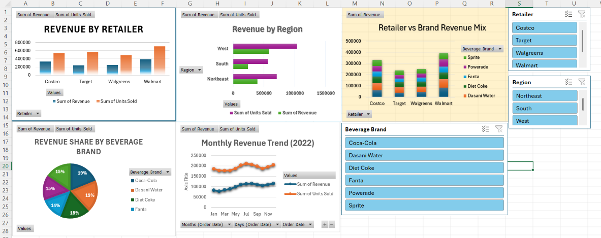

# Multi-Retailer Sales Analysis

Excel project that consolidates four retailer sales files with Power Query and analyzes them using PivotTables, charts, and slicers.

**Tools:** Excel, Power Query, PivotTables, Slicers

## Overview

- **4 retailer files** (Costco, Target, Walgreens, Walmart) consolidated into one table of **288 order lines** using Power Query
- **2022** sales data across **6 beverage brands** and **3 regions** (West, South, Northeast)
- Total revenue of **1,213,017.50** and **2,309,850 units** sold

## Key Findings

- **Walmart** had the highest revenue (**391,767.50**), followed by Costco (331,750).
- **West** was the top region by revenue (582,400).
- **Dasani Water** (233,775) and **Coca-Cola** (228,445) led brand revenue.
- Monthly revenue was lowest in February (78,562.50) and peaked in August (115,950).

## What's in the Workbook

- **Retailers:** the consolidated dataset, with added `Order Month` and `Payment Delay (Days)` columns
- **Sheet 1:** 5 PivotTables (revenue and units by retailer, region, brand, month, and retailer-by-brand)
- **Dashboard:** 5 charts with slicers for Retailer, Region, and Beverage Brand

## Files

- `Retailer_Sales_Dashboard.xlsx`: the Excel workbook
- `retail-sales-overview.png`: dashboard screenshot

## Data

Practice dataset used in an Excel training exercise.

## Author

Abdullah Al Rafi Shakib, BSc in Statistics, Jagannath University, Dhaka
Email: alrafisakib07@gmail.com
